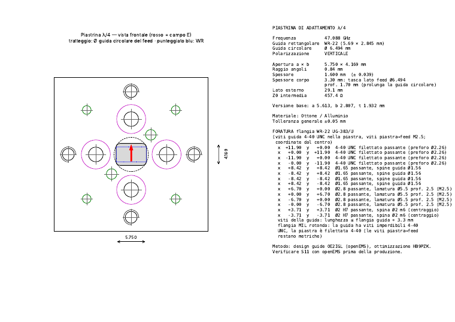
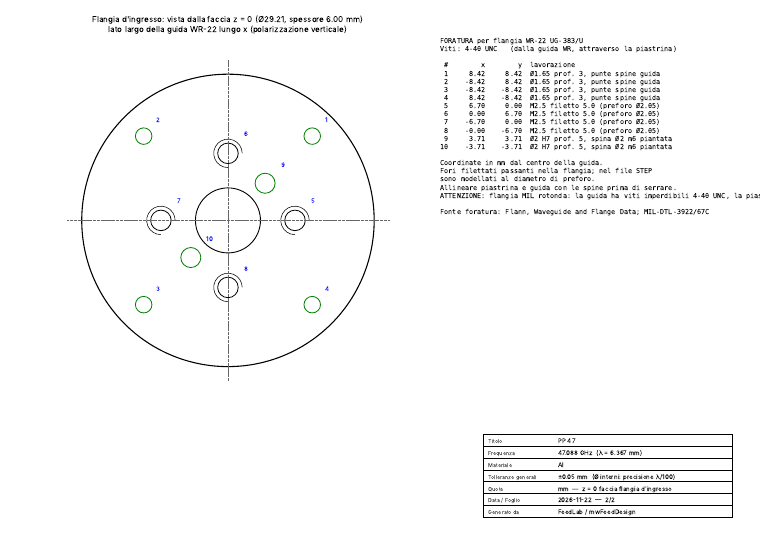

# FeedLab — Benutzerhandbuch

**Labor für den Entwurf von Mikrowellen-Speisesystemen (Feeds)**
Version {VERSION} BETA TEST · Ivan De Cesaris, IZ0JNY · ivan@iz0jny.it

---

## 1. Was ist FeedLab
FeedLab dient zum **Entwerfen, Simulieren und Bauen von Speisesystemen (Feeds) für Parabolspiegel** von **10 bis 134 GHz**. Mit FeedLab:
- wählst du den Spiegel (Katalog oder eigener Spiegel) und das Band;
- erhältst du das passende Speisesystem mit seinen Maßen;
- siehst du Diagramm, Wirkungsgrad, S11, Gewinn und G/T;
- änderst du Maße und siehst sofort, ob das Ergebnis für TX, RX oder EME besser wird;
- erzeugst du die **mechanische PDF-Zeichnung** und die Dateien **.stp** / **.stl** für die Werkstatt;
- entwirfst du die **λ/4-Platte** zum Rechteckhohlleiter WR, mit Bohrungen, Gewinden und Stiften;
- prüfst du den Entwurf mit **openEMS** (optional) und korrigierst ihn automatisch.

Die Berechnungen beruhen auf dem *W1GHZ Online Microwave Antenna Book* (Paul W1GHZ), den Design Guides von Gerald OE2IGL, den Büchern von Balanis und Kildal und den Arbeiten von Al W5LUA, Jeff WA6KBL, Sergei RW3BP, Luis CT1DMK, Mirek OK2AQ und Ivan IZ0JNY. Die vollständige Liste steht im Fenster **ℹ️ Credits**.

## 2. BETA-TEST-Version
Dies ist eine **Testversion**: Sie gilt **30 Tage ab der ersten Installation** und schaltet sich danach ab.
- Bei jedem Start zeigt ein **Popup** das Ablaufdatum und die verbleibenden Tage: mit **OK** schließen.
- Nach Ablauf zeigt FeedLab nur den Hinweis und einen Link zur GitHub-Seite **Releases**: lade die neueste Version herunter und installiere sie.
- Jede neue Version hat ihre eigenen 30 Tage. Wird die PC-Uhr zurückgestellt, gilt die Version als abgelaufen.


## 3. Installation
### Windows (empfohlen)
1. Lade die neueste Version von der Seite **Releases** des GitHub-Repositorys (IZ0JNY/FeedLab) herunter.
2. **Installer:** starte `FeedLab-Setup-x.y.z.exe`. Administratorrechte sind nicht nötig. Danach steht FeedLab im Startmenü.
3. **Portable Version:** entpacke `FeedLab-x.y.z-portable.zip` in einen Ordner und doppelklicke auf `FeedLab.bat`. Es wird nichts im System installiert.

FeedLab öffnet sich in einem eigenen Fenster (Microsoft Edge WebView2, in Windows 11 enthalten). Ohne WebView2 öffnet es sich im Browser.

### Linux / macOS (aus dem Quellcode)
```
pip install -e .
feedlab-gui
```

### Sprache
Oben in der Seitenleiste: **Lingua / Language**. Es gibt sieben Sprachen: Italiano, English, Deutsch, Français, Español, Русский, Português. Der Installer fragt nach der Sprache; die Schaltfläche **📖 Handbuch** öffnet das Handbuch in der gewählten Sprache.

## 4. Die Seitenleiste
| Eintrag | Verwendung |
|---|---|
| **Band** | Betriebsfrequenz (Amateurfunkbänder 10–134 GHz oder *Andere Frequenz…*) |
| **λ** | zugehörige Wellenlänge |
| **Spiegel / Speisesystem** | Zusammenfassung der Wahl im Assistenten |
| **Material des Speisesystems** | Kupfer, versilbertes Kupfer, Messing, Aluminium, metallisierter 3D-Druck…: FeedLab berechnet Verluste und Zusatzrauschen |
| **Ø40-mm-Kragen** | fügt den Kragen für handelsübliche LNB-Halter hinzu |
| **ℹ️ Credits** | Autor, Version und alle Quellen |
| **📖 Handbuch** | lädt dieses Handbuch als PDF herunter |
| **🐞 Problem melden** | öffnet die GitHub-Seite für Fehlermeldungen mit bereits ausgefüllter Version und Projekt |

## 5. Assistent


1. **Spiegel:**
   - *Katalog*: Gibertini, Triax, Fracarro, Fuba, Kathrein, Channel Master/Andrew, Prodelin, Edmund und weitere, mit der Quelle jedes Werts;
   - *eigener Spiegel*: Offset oder Primärfokus.
2. **Daten des eigenen Spiegels:**
   - Offset: aus Durchmesser + f/D, Durchmesser + Brennweite, **Messungen vor Ort** (lange Achse, kurze Achse, Tiefe) oder Ausleuchtungswinkel;
   - Primärfokus: aus f/D oder Tiefe.
3. **Polarisation, Ziel und Fertigung:** linear oder zirkular; **Gewinn** (TX) oder **G/T** (RX/EME); Drehbank oder Blech.
4. **🔎 Bestes Speisesystem finden:** FeedLab vergleicht die geeigneten Feeds und ordnet sie nach geschätztem Wirkungsgrad, mit Begründungen und Warnungen.
5. **✅ Dieses Speisesystem verwenden:** die anderen Reiter arbeiten mit diesem Entwurf.


**Ist die Brennweite nicht veröffentlicht** (bei vielen Kathrein- und Channel-Master-Spiegeln), zeigt der Katalog das an. Verwende *Messungen vor Ort*: spanne eine Schnur entlang der langen Achse und miss die Tiefe in der Mitte.

### 5.1 Feed-Typen
| Feed | Wann verwenden |
|---|---|
| **Axial gerillt, 8 Rillen (Gerald OE2IGL)** | 10–76 GHz, f/D 0.33–0.9 (Offset bis 0.8): 81–86 %, der effizienteste; Maße aus der Tabellenkalkulation v1.4 abhängig vom Öffnungswinkel |
| **W2IMU, Pickett-Potter, Skobelev, Large W2IMU** | Dual-Mode für Offset und f/D 0.5–0.95; Pickett-Potter und großer W2IMU auch über 76 GHz |
| **Super-VE4MA, Chaparral, offener Hohlleiter** | tiefe Primärfokusspiegel (f/D < 0.5) |
| **Kegelhorn f/D 0.6 / Rillenhorn f/D 0.8 (Mirek OK2AQ)** | Offset-Feeds, entworfen für 24.048 GHz und in λ auf andere Bänder skaliert; das Rillenhorn ist aus der Zeichnung abgeleitet: mit openEMS prüfen |
| **Rechteckhorn** | nur lineare Polarisation, direkt aus WR-Hohlleiter gespeist |

Feeds für 1296 MHz (zum Beispiel das Septum von Zdeněk OK1DFC) liegen außerhalb des Bereichs von FeedLab, der bei 10 GHz beginnt.

## 6. Feed-Entwurf
Zeigt die Maße (mm und λ), den Axialschnitt und die verwendete Entwurfsregel (W1GHZ, OE2IGL, Skobelev…). Die Maße lassen sich von Hand ändern. Beim axial gerillten Feed änderst du Teilung, Rillenbreite, Stufe, Durchmesser und Tiefen d1…d8.


## 7. Labor
Hier wird mit den Maßen „gespielt“.


**Einsatzszenario:** Ziel **TX** (Gewinn), **RX** (G/T) oder **EME** (Gewinn + G/T); Elevation, LNA-Rauschzahl, Leitungsverlust, Oberflächenrauheit, Zenitdämpfung.

**Schieberegler der Maße:** bei jeder Änderung berechnet FeedLab Wirkungsgrad, Gewinn, G/T, Antennentemperatur, S11, Randabfall und die Änderung des **S/N-Verhältnisses**:

| Ziel | S/N-Änderung |
|---|---|
| TX | ΔSNR = ΔG |
| RX | ΔSNR = Δ(G/T) |
| EME | ΔSNR = ΔG + Δ(G/T) |

**Hinweise** im Klartext, **Empfindlichkeit** jedes Maßes und **automatische Optimierung** mit S11-Grenze.

### 7.1 Fertigungstoleranzen und Ausbeute

1. **Parameter:** Werkstatttoleranz (±mm); Verteilung *gleichmäßig* (vorsichtig) oder *normal mit ±t = 3σ* (fähige CNC); zulässiger Verlust und maximales S11.
2. **🎲 Toleranzen analysieren:** FeedLab simuliert Tausende Teile und liefert die **Ausbeute** (gute Teile), den mittleren Verlust, die Streuung des Wirkungsgrads, das schlechteste S11 und die **kritischen Maße** mit der **empfohlenen Toleranz** für jedes.
3. **📄 Diese Toleranzen in der PDF-Zeichnung verwenden:** fügt die Toleranztabelle in die Zeichnung ein.
4. **🛡️ Robuste Optimierung:** sucht Maße, die *innerhalb der Toleranzen* gut bleiben (Mittelwert − k·σ). Nützlich über 47 GHz.

## 8. Simulation & S11

- **S11** im Band mit dem schnellen *Mode-Matching*-Löser.
- **Moden in der Apertur:** bei Pickett-Potter und Skobelev auch das Verhältnis **TM11/TE11** (etwa 15 %, WA6KBL).
- **Diagramm** polar und kartesisch, E- und H-Ebene, mit Phase.
- **Spiegelwirkungsgrad** über f/D: Spillover, Ausleuchtung, Phase und Polarisation.
- **Phasenzentrum** und G/T.

Der schnelle Löser behandelt keine Feeds mit Ringen oder Rillen (VE4MA, Chaparral, gerillt): dafür verwendet FeedLab den vom Autor veröffentlichten Wirkungsgrad und empfiehlt openEMS.

## 9. 3D-Diagramm und 3D-Modell


## 10. Zeichnung & STEP

- **📄 PDF erstellen:** mechanische A4-Zeichnung mit bemaßtem Schnitt, Maßtabelle (mm und λ), Schriftfeld und Allgemeintoleranzen. Mit Einzeltoleranzen (§7.1) enthält sie deren Tabelle; mit Befestigungsbohrungen (§11) zeigt ein **Blatt 2** den gebohrten Flansch.
- **🧊 STEP erstellen:** `.stp`-Datei für CNC/CAD. Gewindebohrungen haben den Kernlochdurchmesser; das Gewinde steht im PDF.
- **🖨️ STL erstellen:** für den 3D-Druck.

## 11. WR-Platte


Die **λ/4-Platte** verbindet den Rundhohlleiter des Feeds mit dem Rechteckhohlleiter WR. Die Lage des WR bestimmt die **vertikale oder horizontale Polarisation** (Design Guide OE2IGL, Optimierung HB9PZK).

1. **Daten:** WR-Hohlleiter, Polarisation, Ø des Rundhohlleiters, Fräserradius in den Ecken.
2. **Ergebnis:** Öffnung a × b, Dicke (mit Toleranz) und Zwischen-Z0.
3. **Befestigungsbohrungen Hohlleiter → Platte → Feed**, mit **metrischen** oder **Zoll**-Schrauben:
   - das Bohrbild des **Normflanschs** (Flann / MIL-DTL-3922) wird **in die Platte geschnitten**;
   - **4 Schrauben Platte → Feed** mit dem **Kopf in einer Senkung** auf der Hohlleiterseite, damit die Fläche zum Hohlleiter eben bleibt;
   - **Zentrierstifte** ab **47 GHz**;
   - runde Flansche UG-383/385/387: Bohrungen für die Hohlleiterstifte und Gewinde 4-40;
   - ist die Platte zu dünn, verdickt FeedLab ihren Körper und fräst auf der Feedseite eine **Tasche** mit dem Durchmesser des Rundhohlleiters.
4. Dasselbe Bohrbild wird auf den **Feed-Flansch** übertragen.




**Prüfe die Maße immer vor dem Bohren**, auch die Schraubenköpfe (ISO 4762) gegenüber den gekauften Schrauben.

## 12. Full-wave openEMS (optional)

openEMS ist ein freier FDTD-Löser. Eine Simulation dauert Minuten bis Stunden und läuft im Hintergrund: FeedLab kann geschlossen werden.

| Unterreiter | Verwendung |
|---|---|
| ① **Installation** | geführte Installation von openEMS und der Python-Anbindung, mit Abschlusstest |
| ② **Neue Analyse** | Einzelrechnung, Gitterkonvergenz, Parameter-Sweep; Schätzung von Dauer und RAM |
| ③ **Simulationen** | Fortschritt, Stopp, Log |
| ④ **Ergebnisse** | S11/VSWR, Ko- und Kreuzpolar-Diagramme, Phasenzentrum, Wirkungsgrad, G/T, Vergleich mit dem schnellen Modell; HTML-Bericht, CSV und W1GHZ-`.dat` |
| ⑤ **Space Mapping** | automatische Korrektur des schnellen Modells mit openEMS |

**Space Mapping:** openEMS prüft einen Kandidaten, die Abweichung zwischen openEMS und schnellem Modell korrigiert das schnelle Modell, und FeedLab schlägt den nächsten Kandidaten vor, bis zur Konvergenz. Danach *✅ Besten Entwurf übernehmen*.


## 13. Empfohlener Ablauf
1. **Assistent:** Spiegel, Band, Ziel → Feed.
2. **Labor:** Maße mit Blick auf ΔS/N verfeinern, dann automatische Optimierung.
3. **Toleranzen:** Werkstatttoleranz erfragen und Ausbeute analysieren.
4. **(Optional) openEMS:** Prüfung oder Space Mapping (unverzichtbar für gerillte und Ring-Feeds).
5. **WR-Platte:** Polarisation, Befestigungsbohrungen, PDF und STEP.
6. **Zeichnung & STEP des Feeds** an die Werkstatt.
7. **Im Feld:** Sonnenrauschen messen und mit dem erwarteten Wert vergleichen.

## 14. Bekannte Grenzen
- **Schneller Löser:** modelliert die Apertur als Flansch und behandelt keine Ringe und Rillen. Dafür openEMS verwenden.
- **Wirkungsgrade:** berechnete Werte. Am realen Spiegel 12–15 Punkte weniger erwarten; die *Unterschiede* zwischen Varianten sind zuverlässig.
- **Spiegelkatalog:** einige Brennweiten sind Schätzungen (als solche gekennzeichnet). Miss deinen Spiegel.
- **Zirkulare Polarisation:** der Polarisator (Septum oder Dielektrikum) wird von FeedLab noch nicht entworfen.

## 15. Ein Problem melden
Drücke **🐞 Problem melden** in der Seitenleiste: GitHub öffnet sich mit Version, System und Projekt bereits eingetragen. Beschreibe, was passiert ist, was du erwartet hast und wie man es nachstellt.

## 16. Hauptquellen

- **Paul W1GHZ:** W1GHZ Online Microwave Antenna Book.
- **Gerald OE2IGL:** Design Guides, axial gerillter Feed v1.4; **HB9PZK**.
- **Bücher:** C. A. Balanis, *Antenna Theory*; P.-S. Kildal, *Foundations of Antenna Engineering*.
- **Artikel:** Al W5LUA, Jeff WA6KBL (DUBUS), Sergei RW3BP, Luis CT1DMK, Luis CT1DMK und Willi LX1DB, Mirek OK2AQ, Ivan IZ0JNY.
- **Flansche:** Flann Microwave, *Waveguide and Flange Data*; MIL-DTL-3922/67C.
- **Software:** openEMS; CadQuery / OpenCascade; Streamlit; Plotly; NumPy / SciPy.

Die vollständige Liste steht im Fenster **ℹ️ Credits**.
