# FeedLab — Manuale d'uso

**Laboratorio di Progettazione di feed/illuminatori a microonde**
Versione {VERSION} · Ivan De Cesaris, IZ0JNY · ivan@iz0jny.it

---

## 1. Cos'è FeedLab
FeedLab serve a **progettare, simulare e costruire illuminatori (feed) per parabole** da **10 a 134 GHz**. Con FeedLab:
- scegli la parabola (catalogo commerciale o parabola tua) e la banda;
- ottieni il feed più adatto con le sue quote;
- vedi lobo, efficienza, S11, guadagno e G/T;
- modifichi le quote e vedi subito se il risultato migliora o peggiora, per TX, RX o EME;
- produci il **disegno meccanico PDF** e i file **.stp** / **.stl** per l'officina;
- progetti la **piastrina λ/4** di passaggio alla guida rettangolare WR, con fori, filettature e spine;
- verifichi il progetto con **openEMS** (facoltativo) e lo correggi automaticamente.

I calcoli si basano su:
- il *W1GHZ Online Microwave Antenna Book* (Paul Wade, W1GHZ);
- le design guide di OE2IGL;
- i libri di Balanis e Kildal;
- i lavori di W5LUA, WA6KBL e IZ0JNY.

L'elenco completo è nella finestra **ℹ️ Credits**.

## 2. Installazione
### Windows (consigliato)
1. Scarica l'ultima versione dalla pagina **Releases** del repository GitHub.
2. **Installer:** avvia `FeedLab-Setup-x.y.z.exe`. Non servono diritti di amministratore. Al termine trovi FeedLab nel menu Start.
3. **Versione portatile:** estrai `FeedLab-x.y.z-portable.zip` in una cartella e fai doppio clic su `FeedLab.bat`. Non installa niente nel sistema.

FeedLab si apre in una finestra propria, che usa Microsoft Edge WebView2, già presente in Windows 11. Se WebView2 manca, il programma si apre nel browser.

### Linux / macOS (da sorgente)
```
pip install -e .
feedlab-gui
```

### Lingua
In alto nella barra laterale: **Lingua / Language** (italiano, English, Deutsch, Français, Español).

## 3. La barra laterale
| Voce | Uso |
|---|---|
| **Banda** | frequenza di lavoro (bande radioamatoriali 10–134 GHz o *Altra frequenza…*) |
| **λ** | lunghezza d'onda corrispondente |
| **Parabola / Feed** | riepilogo della scelta fatta nella procedura guidata |
| **Materiale del feed** | rame, rame argentato, ottone, alluminio, stampa 3D metallizzata…: FeedLab calcola perdite e rumore aggiunto |
| **Collare Ø40 mm** | aggiunge al feed il collare per i portaLNB commerciali |
| **ℹ️ Credits** | autore, versione e tutte le fonti |
| **🐞 Segnala un problema** | apre la pagina GitHub delle segnalazioni con versione e progetto già compilati |
| **📖 Manuale** | apre questo manuale |

## 4. Procedura guidata
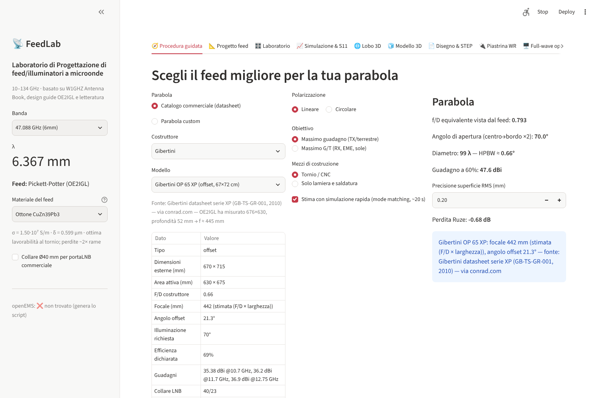

1. **Parabola:**
   - *catalogo*: Gibertini, Triax, Fracarro, Fuba, Kathrein, Channel Master/Andrew, Prodelin, Edmund e altre, con la fonte di ogni dato;
   - *parabola custom*: offset o prime focus.
2. **Dati della parabola custom:**
   - offset: da diametro + f/D, da diametro + focale, da **misure sul campo** (asse lungo, asse corto, profondità) o da angolo di illuminazione;
   - prime focus: da f/D o da profondità.
3. **Polarizzazione, obiettivo e lavorazione:**
   - polarizzazione lineare o circolare;
   - obiettivo **guadagno** (TX) o **G/T** (RX/EME);
   - mezzi di lavorazione (tornio, lamiera…).
4. **Trova il feed migliore:** FeedLab confronta i feed adatti e li ordina per efficienza stimata, con motivazioni e avvertenze.
5. **Usa questo feed:** le altre schede lavorano su quel progetto.

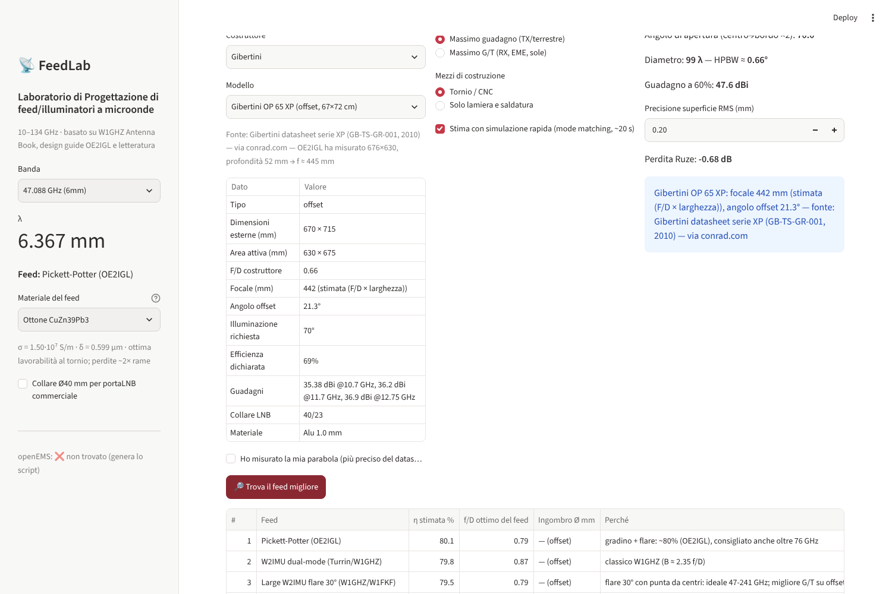

**Se la focale non è pubblicata** (succede per molte parabole Kathrein e Channel Master), il catalogo lo indica. Usa *misure sul campo*: tendi un filo lungo l'asse lungo e misura la profondità al centro.

## 5. Progetto feed
Mostra le quote del feed (in mm e in λ), la sezione assiale e la regola di progetto usata (W1GHZ, OE2IGL, Skobelev…). Le quote si possono modificare a mano.

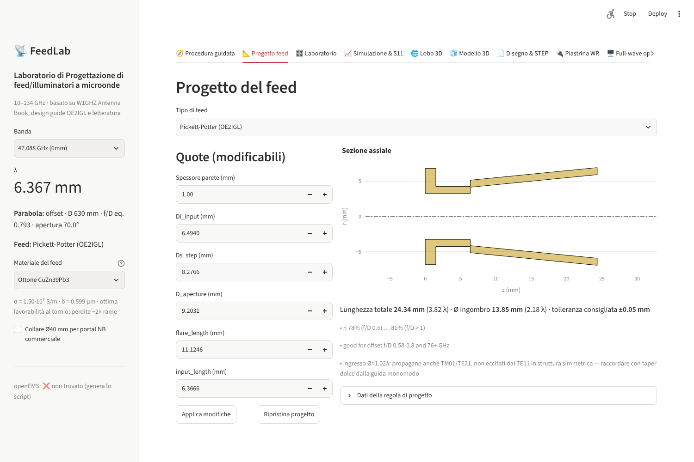

## 6. Laboratorio
Qui si "gioca" con le quote.

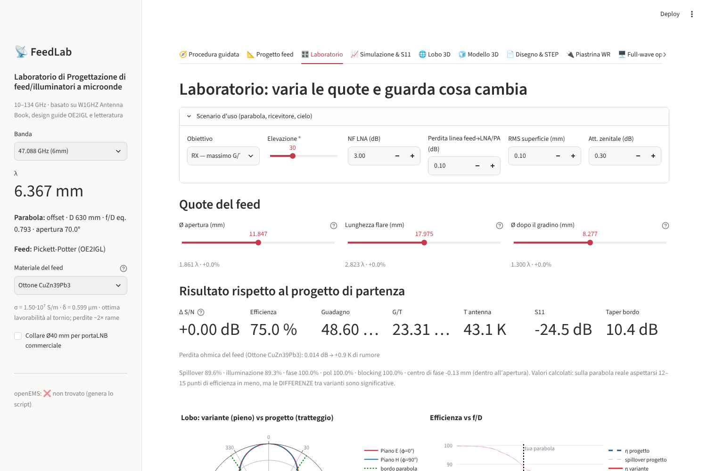

**Scenario d'uso:**
- obiettivo **TX** (guadagno), **RX** (G/T) o **EME** (guadagno + G/T);
- elevazione, NF del LNA, perdita di linea, rugosità della superficie, attenuazione zenitale.

**Cursori delle quote:** a ogni modifica FeedLab ricalcola efficienza, guadagno, G/T, temperatura d'antenna, S11, taper al bordo e la variazione del **rapporto S/N**:

| Obiettivo | Variazione di S/N |
|---|---|
| TX | ΔSNR = ΔG |
| RX | ΔSNR = Δ(G/T) |
| EME | ΔSNR = ΔG + Δ(G/T) |

**Consigli:** suggerimenti in chiaro, per esempio "taper troppo basso: aumenta l'apertura", "TM11 fuori dal 15% di Pawlan" e così via.

**Sensibilità:** quanto conta ogni quota (curva su ±span).

**Ottimizzazione automatica:** cerca le quote migliori per l'obiettivo, con un limite di S11.

### 6.1 Tolleranze di lavorazione e resa
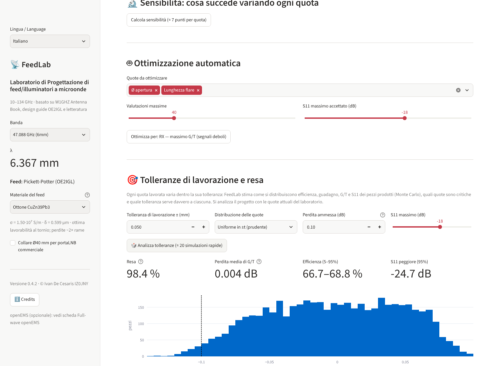
1. **Parametri:**
   - tolleranza dell'officina (±mm);
   - distribuzione: *uniforme* (prudente) o *normale con ±t = 3σ* (CNC capace);
   - perdita ammessa e S11 massimo.
2. **🎲 Analizza tolleranze:** in circa 10 s FeedLab simula migliaia di pezzi prodotti e dà:
   - **resa**: percentuale di pezzi buoni;
   - perdita media, dispersione dell'efficienza, S11 peggiore;
   - **quote critiche**, con la **tolleranza consigliata** per ciascuna. Solo quelle quote richiedono lavorazioni strette.
3. **📄 Usa queste tolleranze nel disegno PDF:** aggiunge la tabella delle tolleranze al disegno.
4. **🛡️ Ottimizzazione robusta:** cerca le quote che restano buone *dentro le tolleranze* (media − k·σ) invece del picco più stretto. Utile sopra i 47 GHz.

## 7. Simulazione & S11
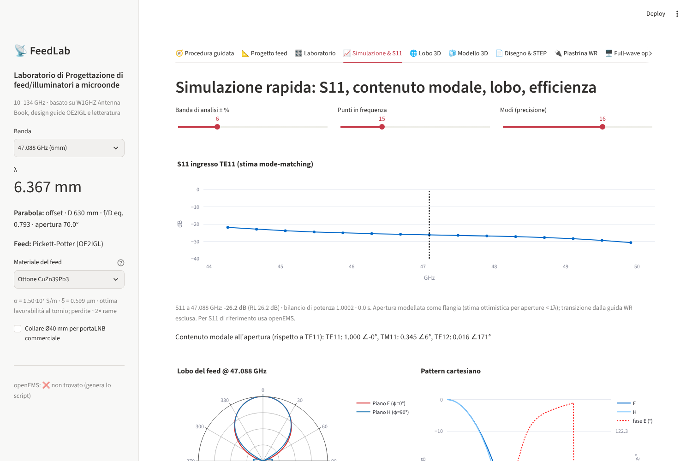
- **S11:** in banda, calcolato con il simulatore rapido a *mode matching*.
- **Modi all'apertura:** per Pickett-Potter e Skobelev anche il rapporto **TM11/TE11**, che dovrebbe essere circa il 15% (WA6KBL).
- **Lobo:** polare e cartesiano, piani E e H, con la fase.
- **Efficienza della parabola** in funzione di f/D, scomposta in spillover, illuminazione, fase e polarizzazione.
- **Centro di fase** e G/T.

Il simulatore rapido è preciso dentro il feed. L'apertura invece è modellata in modo approssimato, quindi S11 è ottimistico sotto 1λ. Per il riferimento usa openEMS (§11).

## 8. Lobo 3D e Modello 3D
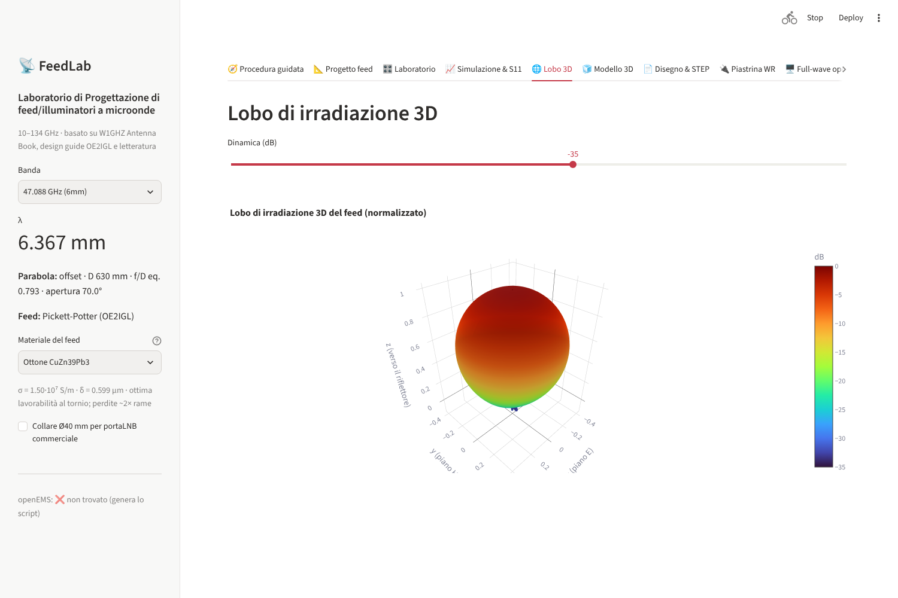
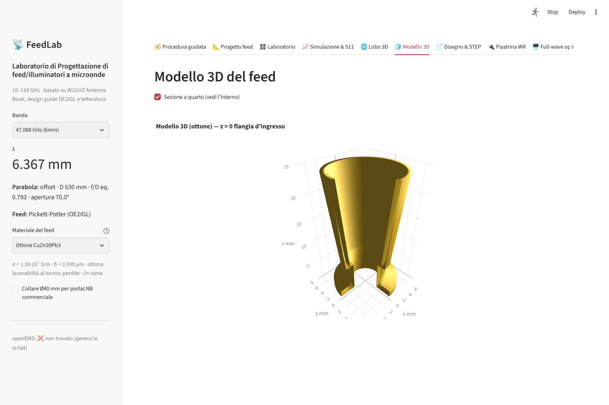

## 9. Disegno & STEP
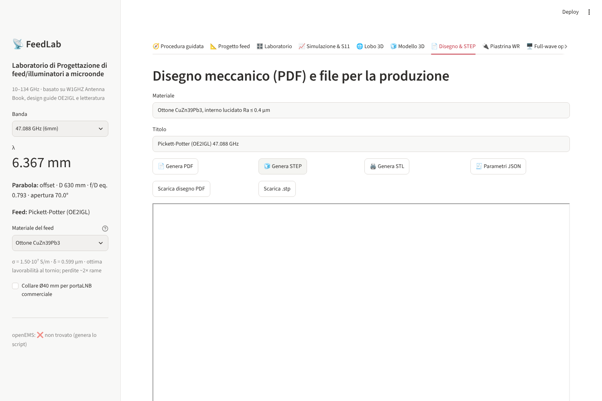
- **📄 Genera PDF:** disegno meccanico A4 con sezione quotata, tabella delle quote (mm e λ), cartiglio e tolleranze generali.
  - Se hai attivato le tolleranze per quota (§6.1), il disegno include la loro tabella.
  - Se hai attivato i fori di fissaggio (§10), c'è un **foglio 2** con la flangia forata e la tabella dei fori.
- **🧊 Genera STEP:** file `.stp` per CNC/CAD (CadQuery/OpenCascade). I fori ci sono veri; quelli filettati sono al diametro di preforo e il filetto è indicato nel PDF.
- **🖨️ Genera STL:** per la stampa 3D.

## 10. Piastrina WR
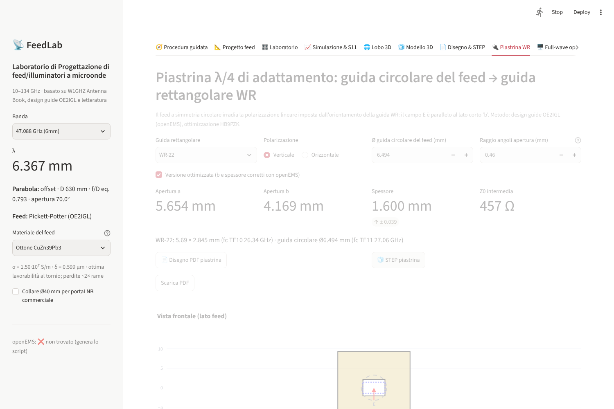

La **piastrina λ/4** collega la guida circolare del feed alla guida rettangolare WR. L'orientamento della WR fissa la **polarizzazione verticale o orizzontale**. Il metodo è la design guide OE2IGL con l'ottimizzazione HB9PZK.

1. **Dati:** guida WR, polarizzazione, Ø della guida circolare del feed, raggio della fresa negli angoli.
2. **Risultato:** apertura a × b, spessore (con tolleranza) e Z0 intermedia.
3. **Fori di fissaggio guida → piastrina → feed**, con viti **metriche** o **in pollici**:
   - la foratura della **flangia standard** della guida (tabelle Flann / MIL-DTL-3922) è **filettata nella piastra**: le viti della guida si avvitano lì;
   - **4 viti piastra → feed** con la **testa nella lamatura** sul lato guida, così la superficie verso la guida resta piana;
   - **spine di centraggio** piastra–feed da **47 GHz in su**;
   - flange rotonde UG-383/385/387: fori per le spine della guida e filetto 4-40, perché queste guide hanno viti imperdibili 4-40;
   - se la piastra λ/4 è troppo sottile per lamature e filetti, FeedLab ne ingrossa il corpo e ricava sul lato feed una **tasca del diametro della guida circolare**. La parte λ/4 resta invariata.
4. La stessa foratura viene applicata alla **flangia del feed**: FeedLab ne aumenta spessore e diametro, e allunga se serve la guida d'ingresso.


**Verifica sempre le misure prima di forare.** Per il WR-28 (UG-599/U) la tabella Flann riporta valori uguali al WR-62: FeedLab lo segnala. Anche le teste delle viti (ISO 4762) vanno confrontate con le viti che acquisti.

## 11. Full-wave openEMS (facoltativo)
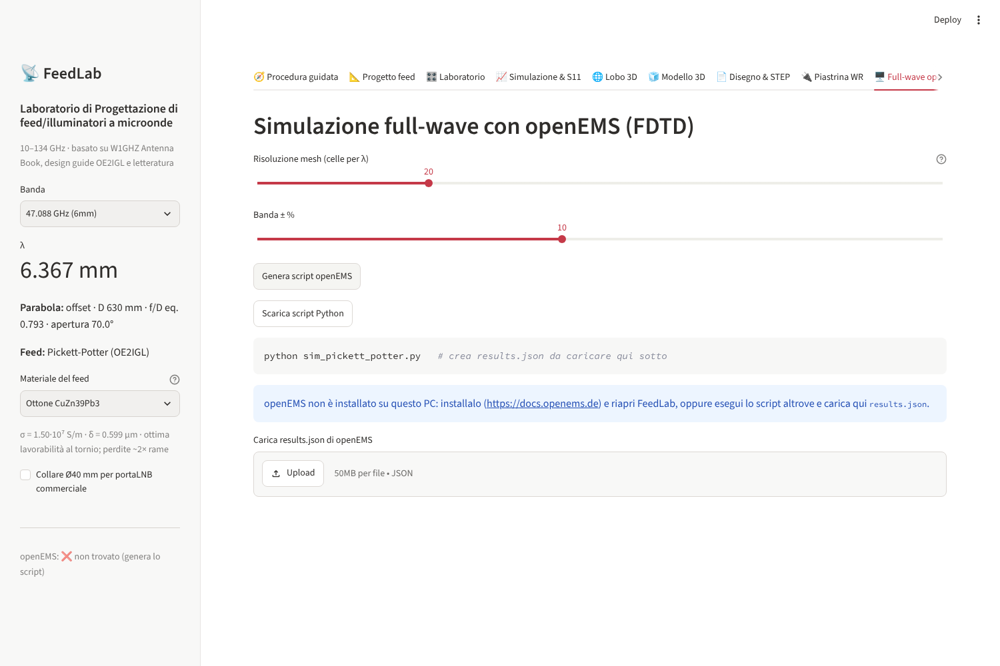
openEMS è un simulatore FDTD gratuito. Una simulazione dura da minuti a ore e gira in background: puoi chiudere FeedLab.

| Sotto-scheda | Uso |
|---|---|
| ① **Installazione** | installazione guidata di openEMS e del suo collegamento con Python, con test finale |
| ② **Nuova analisi** | simulazione singola, convergenza della mesh, sweep di un parametro; stima di durata e RAM |
| ③ **Simulazioni** | avanzamento, stop, log |
| ④ **Risultati** | S11/VSWR, lobi co- e cross-polari, centro di fase, efficienza sulla tua parabola, G/T, confronto col modello rapido; esporta report HTML, CSV e `.dat` W1GHZ |
| ⑤ **Space mapping** | vedi sotto |

**Space mapping.** openEMS verifica un candidato; la differenza tra openEMS e il modello rapido corregge il modello rapido; FeedLab propone il candidato successivo. Il ciclo si ripete fino alla convergenza, anche **da solo**. Alla fine *✅ Applica il migliore al progetto*.

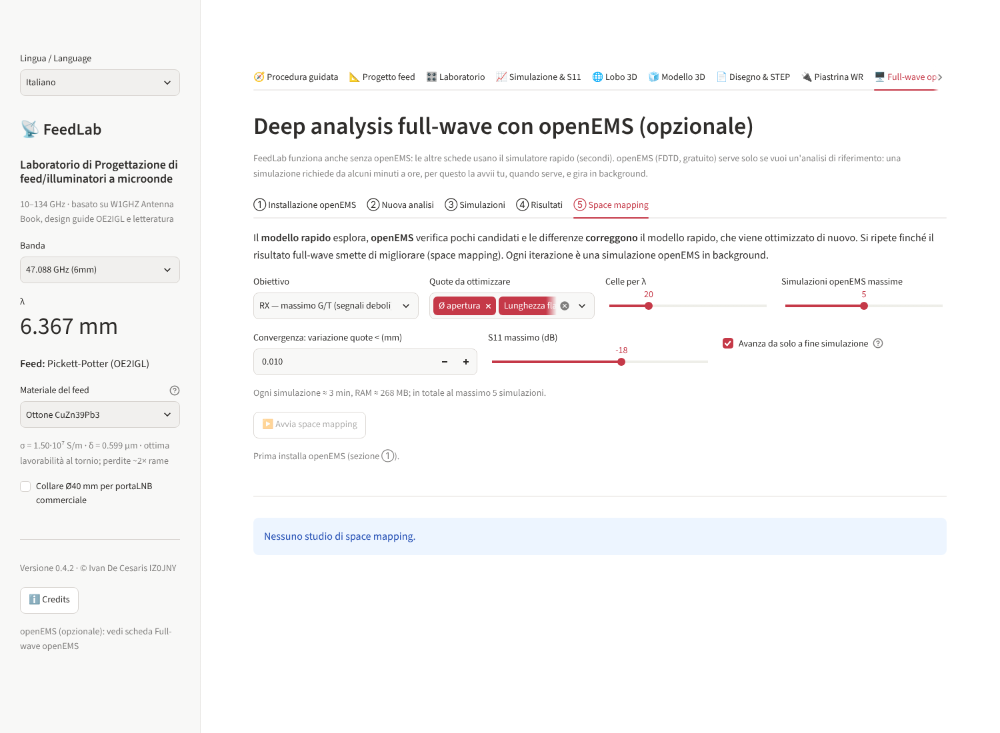

## 12. Flusso di lavoro consigliato
1. **Procedura guidata:** parabola, banda, obiettivo → feed.
2. **Laboratorio:** ritocca le quote guardando ΔS/N, poi l'ottimizzazione automatica.
3. **Tolleranze:** chiedi la tolleranza alla tua officina e analizza la resa; se serve, usa l'ottimizzazione robusta.
4. **(Facoltativo) openEMS:** una simulazione di verifica o lo space mapping.
5. **Piastrina WR:** polarizzazione, fori di fissaggio, PDF e STEP.
6. **Disegno & STEP del feed:** PDF (con le tolleranze) e STEP all'officina.
7. **Sul campo:** misura il rumore solare e confrontalo con il valore atteso.

## 13. Limiti noti
- **Simulatore rapido:** modella l'apertura come flangia e non tratta i feed con choke o anelli (VE4MA, Chaparral). Per questi usa openEMS.
- **Efficienze:** sono valori calcolati. Su una parabola reale aspettati 12–15 punti in meno. Le *differenze* tra varianti, però, sono attendibili.
- **Catalogo parabole:** alcune focali sono stime (indicate come tali). Misura la tua parabola.
- **Polarizzazione circolare:** il polarizzatore (septum o dielettrico) non è ancora progettato da FeedLab.

## 14. Segnalare un problema
Premi **🐞 Segnala un problema** nella barra laterale: si apre GitHub con versione, sistema e progetto già scritti. Descrivi cosa è successo, cosa ti aspettavi e come riprodurlo.

## 15. Fonti principali
- **Paul Wade, W1GHZ:** W1GHZ Online Microwave Antenna Book.
- **Gerald Ihninger, OE2IGL:** design guide; **HB9PZK**.
- **Libri:** C. A. Balanis, *Antenna Theory*; P.-S. Kildal, *Foundations of Antenna Engineering*.
- **Articoli:** Al Ward, W5LUA, *24 GHz EME*; Jeffrey Pawlan, WA6KBL, dual-mode feedhorn (DUBUS); Ivan De Cesaris, IZ0JNY, feed W2IMU 24 GHz.
- **Flange:** Flann Microwave, *Waveguide and Flange Data*; MIL-DTL-3922/67C.
- **Software:** openEMS (T. Liebig); CadQuery / OpenCascade; Streamlit; Plotly; NumPy / SciPy.

L'elenco completo è nella finestra **ℹ️ Credits**.
