# FeedLab — User Manual

**Microwave Feed/Illuminator Design Lab**
Version {VERSION} · Ivan De Cesaris, IZ0JNY · ivan@iz0jny.it

*The screenshots show the Italian interface. Choose English under **Lingua / Language** at the top of the sidebar.*

---

## 1. What FeedLab does
FeedLab helps you **design, simulate and build dish feeds** from **10 to 134 GHz**. With FeedLab you can:
- choose your dish (commercial catalogue or your own dish) and the band;
- get the most suitable feed with its dimensions;
- see the pattern, efficiency, S11, gain and G/T;
- change the dimensions and see at once whether the result gets better or worse, for TX, RX or EME;
- produce the **mechanical PDF drawing** and **.stp** / **.stl** files for the workshop;
- design the **λ/4 plate** to the rectangular WR waveguide, with holes, threads and dowel pins;
- check the design with **openEMS** (optional) and correct it automatically.

The calculations are based on:
- the *W1GHZ Online Microwave Antenna Book* (Paul Wade, W1GHZ);
- the OE2IGL design guides;
- the books by Balanis and Kildal;
- work by W5LUA, WA6KBL and IZ0JNY.

The full list is in the **ℹ️ Credits** window.

## 2. Installation
### Windows (recommended)
1. Download the latest version from the **Releases** page of the GitHub repository.
2. **Installer:** run `FeedLab-Setup-x.y.z.exe`. No administrator rights are needed. FeedLab then appears in the Start menu.
3. **Portable version:** unzip `FeedLab-x.y.z-portable.zip` to a folder and double-click `FeedLab.bat`. Nothing is installed on the system.

FeedLab opens in its own window, which uses Microsoft Edge WebView2 (already in Windows 11). If WebView2 is missing, it opens in the browser.

### Linux / macOS (from source)
```
pip install -e .
feedlab-gui
```

### Language
At the top of the sidebar: **Lingua / Language** (Italiano, English, Deutsch, Français, Español).

## 3. The sidebar
| Item | Use |
|---|---|
| **Band** | working frequency (amateur bands 10–134 GHz or *Other frequency…*) |
| **λ** | the corresponding wavelength |
| **Dish / Feed** | summary of the choice made in the guided procedure |
| **Feed material** | copper, silver-plated copper, brass, aluminium, metallised 3D print…: FeedLab computes losses and added noise |
| **Ø40 mm collar** | adds the collar for commercial LNB holders |
| **ℹ️ Credits** | author, version and all sources |
| **🐞 Report a problem** | opens the GitHub issue page with version and design pre-filled |
| **📖 Manual** | opens this manual |

## 4. Guided procedure
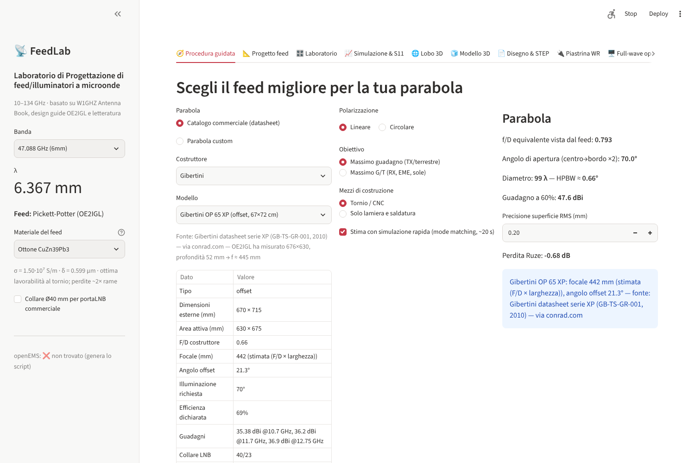

1. **Dish:**
   - *catalogue*: Gibertini, Triax, Fracarro, Fuba, Kathrein, Channel Master/Andrew, Prodelin, Edmund and more, with the source of every value;
   - *custom dish*: offset or prime focus.
2. **Custom dish data:**
   - offset: from diameter + f/D, from diameter + focal length, from **field measurements** (long axis, short axis, depth) or from the illumination angle;
   - prime focus: from f/D or from the depth.
3. **Polarisation, goal and machining:**
   - linear or circular polarisation;
   - goal **gain** (TX) or **G/T** (RX/EME);
   - machining means (lathe, sheet metal…).
4. **Find the best feed:** FeedLab compares the suitable feeds and ranks them by estimated efficiency, with reasons and warnings.
5. **Use this feed:** the other tabs then work on that design.

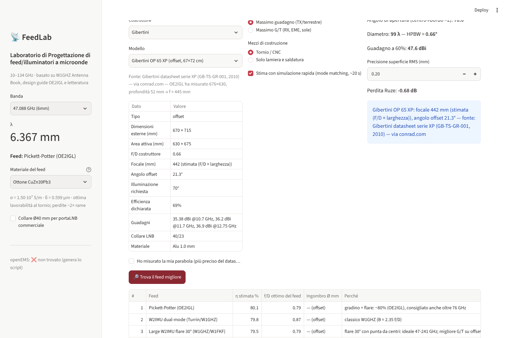

**If the focal length is not published** (as for many Kathrein and Channel Master dishes), the catalogue says so. Use *field measurements*: stretch a string along the long axis and measure the depth at the centre.

## 5. Feed design
Shows the feed dimensions (mm and λ), the axial section and the design rule used (W1GHZ, OE2IGL, Skobelev…). Dimensions can be edited by hand.

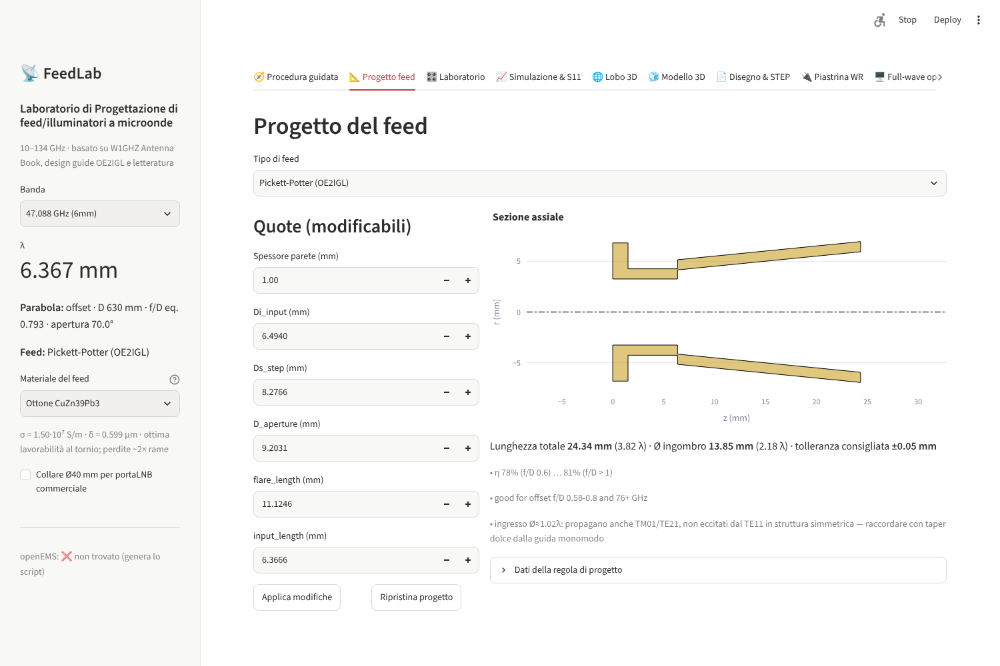

## 6. Laboratory
This is where you "play" with the dimensions.

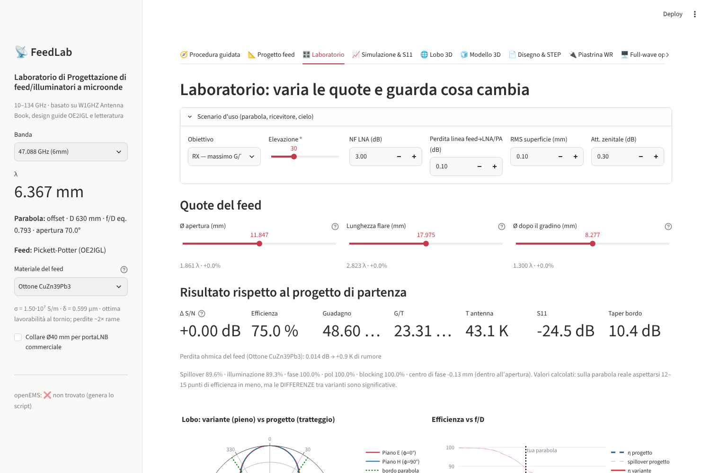

**Scenario:**
- goal **TX** (gain), **RX** (G/T) or **EME** (gain + G/T);
- elevation, LNA noise figure, line loss, surface roughness, zenith attenuation.

**Dimension sliders:** after every change FeedLab recomputes efficiency, gain, G/T, antenna temperature, S11, edge taper and the change of **signal-to-noise ratio**:

| Goal | Change of S/N |
|---|---|
| TX | ΔSNR = ΔG |
| RX | ΔSNR = Δ(G/T) |
| EME | ΔSNR = ΔG + Δ(G/T) |

**Advice:** plain-language hints, for example "taper too low: enlarge the aperture", "TM11 outside Pawlan's 15%" and so on.

**Sensitivity:** how much each dimension matters (curve over ±span).

**Automatic optimisation:** looks for the best dimensions for the goal, with an S11 limit.

### 6.1 Fabrication tolerances and yield
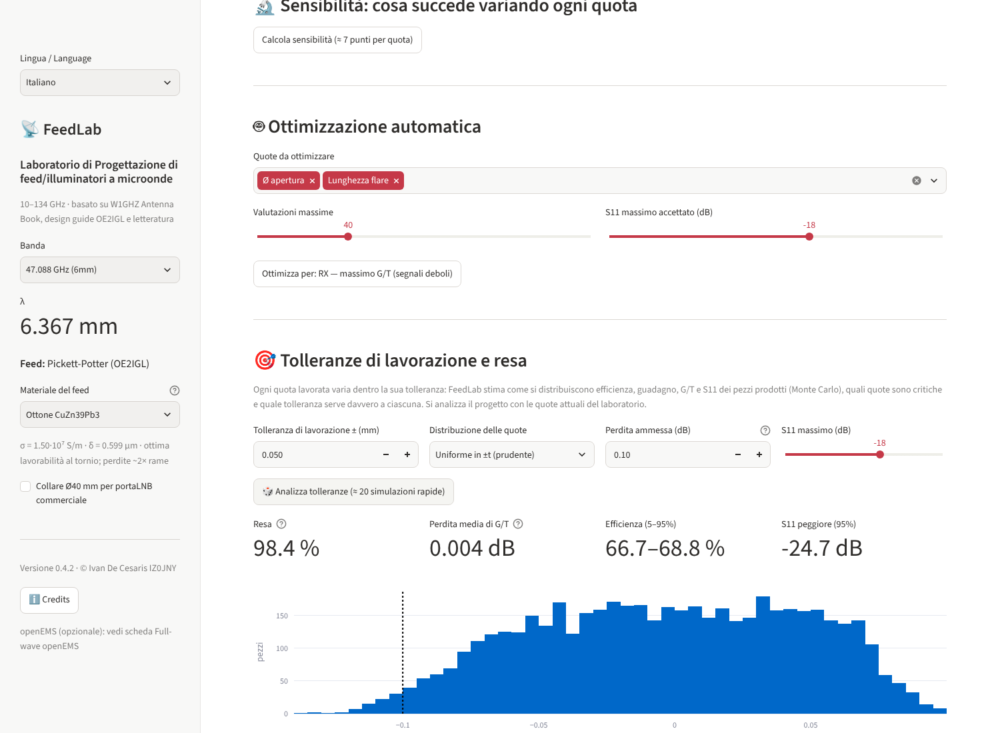
1. **Settings:**
   - your workshop's tolerance (±mm);
   - distribution: *uniform* (conservative) or *normal with ±t = 3σ* (capable CNC);
   - allowed loss and maximum S11.
2. **🎲 Analyse tolerances:** in about 10 s FeedLab simulates thousands of manufactured parts and reports:
   - the **yield**: percentage of good parts;
   - mean loss, efficiency spread, worst S11;
   - the **critical dimensions**, with the **recommended tolerance** for each one. Only those dimensions need tight machining.
3. **📄 Use these tolerances in the PDF drawing:** adds the tolerance table to the drawing.
4. **🛡️ Robust optimisation:** looks for dimensions that stay good *within the tolerances* (mean − k·σ) instead of the sharpest peak. Useful above 47 GHz.

## 7. Simulation & S11
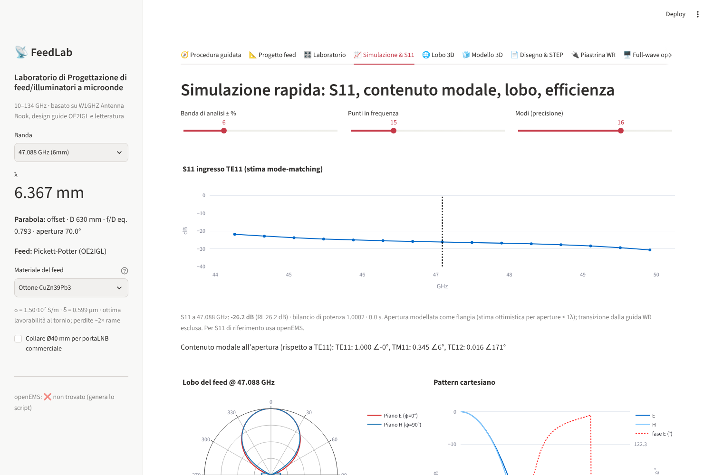
- **S11:** over the band, computed with the fast *mode-matching* solver.
- **Aperture modes:** for Pickett-Potter and Skobelev also the **TM11/TE11** ratio, which should be about 15% (WA6KBL).
- **Pattern:** polar and cartesian, E and H planes, with phase.
- **Dish efficiency** versus f/D, split into spillover, illumination, phase and polarisation.
- **Phase centre** and G/T.

The fast solver is accurate inside the feed. The aperture, however, is modelled approximately, so S11 is optimistic below 1λ. For a reference result use openEMS (§11).

## 8. 3D pattern and 3D model
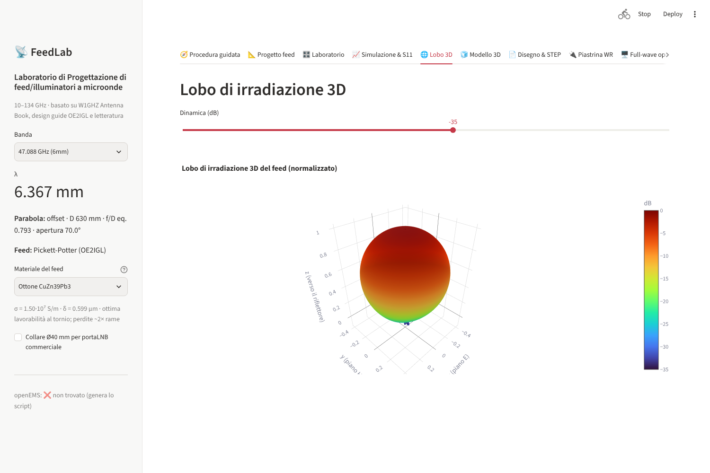
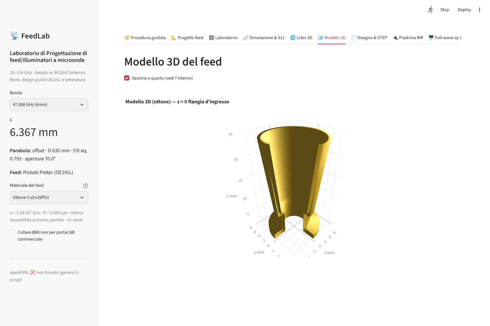

## 9. Drawing & STEP
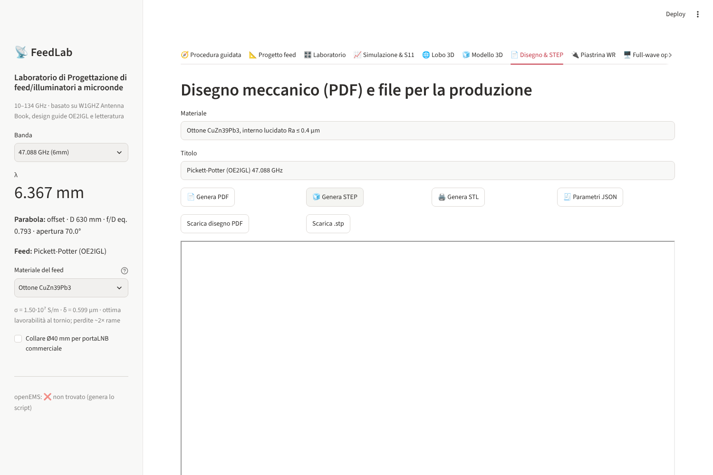
- **📄 Generate PDF:** A4 mechanical drawing with dimensioned section, dimension table (mm and λ), title block and general tolerances.
  - If you enabled per-dimension tolerances (§6.1), the drawing includes their table.
  - If you enabled fixing holes (§10), there is a **sheet 2** with the drilled flange and the hole table.
- **🧊 Generate STEP:** `.stp` file for CNC/CAD (CadQuery/OpenCascade). Holes are real; tapped holes are at tap-drill diameter and the thread is called out in the PDF.
- **🖨️ Generate STL:** for 3D printing.

## 10. WR plate
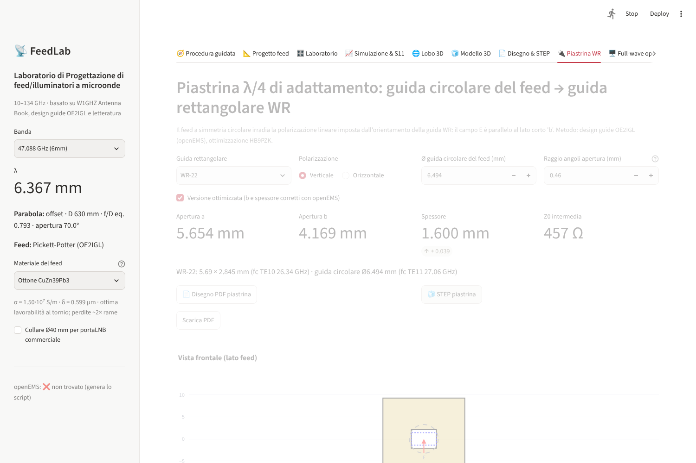

The **λ/4 plate** joins the feed's circular guide to the rectangular WR waveguide. The orientation of the WR sets **vertical or horizontal polarisation**. The method is the OE2IGL design guide with the HB9PZK optimisation.

1. **Inputs:** WR waveguide, polarisation, Ø of the feed's circular guide, cutter radius in the corners.
2. **Result:** aperture a × b, thickness (with tolerance) and intermediate Z0.
3. **Fixing holes waveguide → plate → feed**, with **metric** or **inch** screws:
   - the **standard flange** pattern of the waveguide (Flann / MIL-DTL-3922 tables) is **tapped in the plate**: the waveguide's screws go there;
   - **4 plate → feed screws** with their **heads in counterbores** on the waveguide side, so the face towards the waveguide stays flat;
   - plate–feed **dowel pins** from **47 GHz up**;
   - round UG-383/385/387 flanges: holes for the waveguide's dowels and a 4-40 thread, because these waveguides have captive 4-40 screws;
   - if the λ/4 plate is too thin for counterbores and threads, FeedLab thickens the plate body and adds on the feed side a **pocket of the circular guide's diameter**. The λ/4 section is unchanged.
4. The same pattern is applied to the **feed flange**: FeedLab increases its thickness and diameter and, if needed, lengthens the input guide.


**Always check dimensions before drilling.** For WR-28 (UG-599/U) the Flann table gives the same values as WR-62: FeedLab warns about it. Also compare the screw heads (ISO 4762) with the screws you buy.

## 11. Full-wave openEMS (optional)
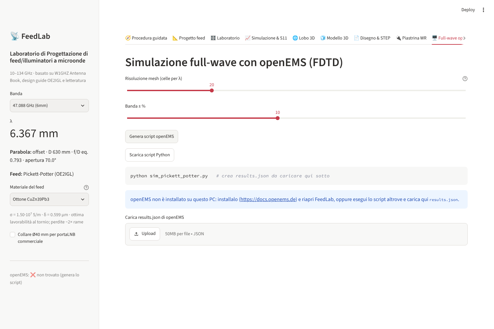
openEMS is a free FDTD solver. A run takes from minutes to hours and works in the background: you can close FeedLab.

| Sub-tab | Use |
|---|---|
| ① **Installation** | guided installation of openEMS and its Python link, with a final test |
| ② **New analysis** | single run, mesh convergence, parameter sweep; time and RAM estimate |
| ③ **Simulations** | progress, stop, log |
| ④ **Results** | S11/VSWR, co- and cross-polar patterns, phase centre, efficiency on your dish, G/T, comparison with the fast model; exports HTML report, CSV and W1GHZ `.dat` |
| ⑤ **Space mapping** | see below |

**Space mapping.** openEMS checks a candidate; the difference between openEMS and the fast model corrects the fast model; FeedLab proposes the next candidate. The loop repeats until convergence, also **automatically**. At the end, *✅ Apply the best to the design*.

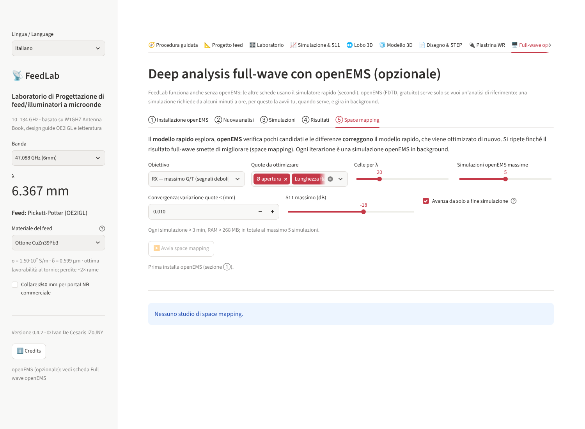

## 12. Recommended workflow
1. **Guided procedure:** dish, band, goal → feed.
2. **Laboratory:** adjust the dimensions watching ΔS/N, then run the automatic optimisation.
3. **Tolerances:** ask your workshop for its tolerance and analyse the yield; if needed, use the robust optimisation.
4. **(Optional) openEMS:** a check run or space mapping.
5. **WR plate:** polarisation, fixing holes, PDF and STEP.
6. **Feed drawing & STEP:** PDF (with tolerances) and STEP to the workshop.
7. **In the field:** measure sun noise and compare it with the expected value.

## 13. Known limitations
- **Fast solver:** models the aperture as a flange and does not handle choke or ring feeds (VE4MA, Chaparral). Use openEMS for those.
- **Efficiencies:** these are computed values. On a real dish expect 12–15 points less. The *differences* between variants, however, are reliable.
- **Dish catalogue:** some focal lengths are estimates (flagged as such). Measure your dish.
- **Circular polarisation:** the polariser (septum or dielectric) is not designed by FeedLab yet.

## 14. Reporting a problem
Press **🐞 Report a problem** in the sidebar: GitHub opens with version, system and design pre-filled. Describe what happened, what you expected and how to reproduce it.

## 15. Main sources
- **Paul Wade, W1GHZ:** W1GHZ Online Microwave Antenna Book.
- **Gerald Ihninger, OE2IGL:** design guides; **HB9PZK**.
- **Books:** C. A. Balanis, *Antenna Theory*; P.-S. Kildal, *Foundations of Antenna Engineering*.
- **Articles:** Al Ward, W5LUA, *24 GHz EME*; Jeffrey Pawlan, WA6KBL, dual-mode feedhorns (DUBUS); Ivan De Cesaris, IZ0JNY, 24 GHz W2IMU feed.
- **Flanges:** Flann Microwave, *Waveguide and Flange Data*; MIL-DTL-3922/67C.
- **Software:** openEMS (T. Liebig); CadQuery / OpenCascade; Streamlit; Plotly; NumPy / SciPy.

The full list is in the **ℹ️ Credits** window.
