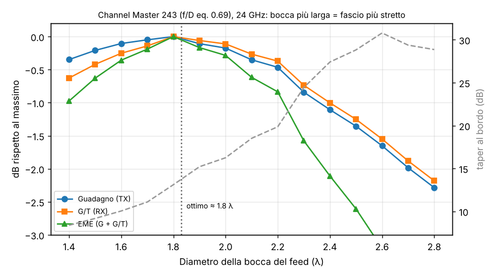

# Studio: feed EME ottimizzato per la Channel Master 243 (10, 24, 47 GHz)

Simulatore veloce di FeedLab (mode matching + efficienza della parabola), parabola offset 2.4 m, f/D equivalente 0.69,
superficie 0.4 mm RMS, elevazione 30°, ricevitore 90 K. Obiettivo EME = guadagno + G/T (SNR delle eco proprie),
con S11 < −25 dB su ±1 % di banda. Risultati da validare con openEMS.

## Conclusioni

1. **Il Dual-Flare IZ0JNY è già praticamente all'ottimo per la 243.** Tre ricerche globali indipendenti (profilo
   liscio libero a 11 parametri, famiglia Dual-Flare a 8 parametri, horn corrugato conico a 7 parametri, migliaia di
   simulazioni) trovano al massimo **+0.014 dB** di EME.
2. **La bocca più larga non aiuta su questa parabola.** Una bocca più grande stringe il fascio del feed: oltre
   circa 1.8 λ la parabola è sotto-illuminata e si perde (−0.8 dB a 2.2 λ, −3 dB a 2.6 λ). Conviene solo su parabole
   più «piatte» (f/D più alto).
3. **Il limite teorico** (lobo cos^q ideale, q ≈ 5) sarebbe EME 86.80 a 24 GHz, cioè 0.5 dB sopra: con la stessa
   percentuale di spillover (94 %) un lobo ideale illumina all'85 % contro l'81–82 % di qualunque feed reale con
   bocca da 1.8 λ. È un limite fisico della dimensione dell'apertura, non del progetto.
4. **Variante utile: Dual-Flare compatto**, lo stesso EME (+0.014 dB) con il feed **16 % più corto**
   (45.7 contro 54.4 mm a 24 GHz, 23.3 contro 27.8 mm a 47 GHz), S11 −26.5 dB.
5. **Horn corrugato**: stesse prestazioni, adattamento eccellente (S11 −36.8 dB) ma lavorazione molto più difficile
   (denti da circa 0.3 mm a 47 GHz): non conviene.
6. **Dove sono davvero i dB** (scheda EMELab → Analisi): a 47 GHz la precisione della superficie (0.4 → 0.2 mm RMS:
   +2 dB di G/T, +4 dB sulle eco) e il puntamento (1/4 di fascio = 0.045°: −1.5 dB sulle eco); a 24 GHz umidità ed
   elevazione (±1 dB sulle eco); a 10 GHz il preamplificatore.

## Confronto (stessa parabola, stesse condizioni)

| GHz | Feed | G (dBi) | G/T (dB/K) | EME | Taper (dB) | S11 max ±1 % (dB) | Lunghezza (mm) | Bocca (mm) |
|---|---|---|---|---|---|---|---|---|
| 10.368 | IZ0JNY Dual-Flare | 47.00 | 25.82 | 72.812 | 13.5 | -28.8 | 126.2 | 53.0 |
| 10.368 | W2IMU | 46.95 | 25.66 | 72.607 | 11.2 | -25.5 | 148.9 | 46.9 |
| 10.368 | Large W2IMU | 46.96 | 25.75 | 72.711 | 13.4 | -24.7 | 178.0 | 51.5 |
| 10.368 | Pickett-Potter | 46.95 | 25.65 | 72.594 | 10.8 | -25.0 | 95.0 | 47.4 |
| 10.368 | Corrugato FeedLab | 47.00 | 25.81 | 72.811 | 13.1 | -36.8 | 133.2 | 51.8 |
| 10.368 | Dual-Flare ottimizzato | 47.01 | 25.81 | 72.823 | 13.0 | -26.5 | 106.0 | 52.5 |
| 24.048 | IZ0JNY Dual-Flare | 53.72 | 32.54 | 86.267 | 13.5 | -28.8 | 54.4 | 22.8 |
| 24.048 | W2IMU | 53.67 | 32.37 | 86.047 | 11.2 | -25.5 | 64.2 | 20.2 |
| 24.048 | Large W2IMU | 53.68 | 32.47 | 86.150 | 13.4 | -24.7 | 76.7 | 22.2 |
| 24.048 | Pickett-Potter | 53.68 | 32.38 | 86.055 | 10.8 | -25.0 | 41.0 | 20.4 |
| 24.048 | Corrugato FeedLab | 53.73 | 32.54 | 86.267 | 13.1 | -36.8 | 57.4 | 22.4 |
| 24.048 | Dual-Flare ottimizzato | 53.74 | 32.54 | 86.281 | 13.0 | -26.5 | 45.7 | 22.6 |
| 47.088 | IZ0JNY Dual-Flare | 57.55 | 36.37 | 93.923 | 13.5 | -28.8 | 27.8 | 11.7 |
| 47.088 | W2IMU | 57.50 | 36.18 | 93.682 | 11.2 | -25.5 | 32.8 | 10.3 |
| 47.088 | Large W2IMU | 57.51 | 36.28 | 93.783 | 13.4 | -24.7 | 39.2 | 11.3 |
| 47.088 | Pickett-Potter | 57.51 | 36.21 | 93.720 | 10.8 | -25.0 | 20.9 | 10.4 |
| 47.088 | Corrugato FeedLab | 57.56 | 36.37 | 93.924 | 13.1 | -36.8 | 29.3 | 11.4 |
| 47.088 | Dual-Flare ottimizzato | 57.57 | 36.37 | 93.941 | 13.0 | -26.5 | 23.3 | 11.6 |

Tolleranze CNC (Monte Carlo, ±0.05/0.03/0.02 mm a 10/24/47 GHz): tutti i feed perdono meno di 0.01 dB.

## Bocca del feed

## Quote del Dual-Flare compatto

**24.048 GHz** (λ = 12.466 mm)

| Quota | Dual-Flare IZ0JNY attuale (mm) | Dual-Flare compatto (mm) |
|---|---|---|
| Di_input | 9.474 | 9.791 |
| Ds_step | 11.897 | 13.810 |
| Ls | 0.969 | 1.172 |
| Dm | 20.372 | 19.359 |
| L1 | 7.200 | 5.491 |
| Lp | 21.979 | 16.183 |
| D_aperture | 22.834 | 22.640 |
| L2 | 16.769 | 15.370 |
| cone1_half_deg | 30.479° | 26.805° |
| cone2_half_deg | 4.198° | 6.093° |
| lunghezza totale | 54.40 | 45.70 |

**47.088 GHz** (λ = 6.367 mm)

| Quota | Dual-Flare IZ0JNY attuale (mm) | Dual-Flare compatto (mm) |
|---|---|---|
| Di_input | 4.839 | 5.000 |
| Ds_step | 6.076 | 7.053 |
| Ls | 0.495 | 0.599 |
| Dm | 10.404 | 9.887 |
| L1 | 3.677 | 2.804 |
| Lp | 11.225 | 8.265 |
| D_aperture | 11.661 | 11.562 |
| L2 | 8.564 | 7.849 |
| cone1_half_deg | 30.479° | 26.805° |
| cone2_half_deg | 4.198° | 6.093° |
| lunghezza totale | 27.78 | 23.34 |

Strumenti: `feedlab/synth.py`, `tools/synth/run_de.py`, `run_df.py`, `run_cg.py`, `compare.py`.
